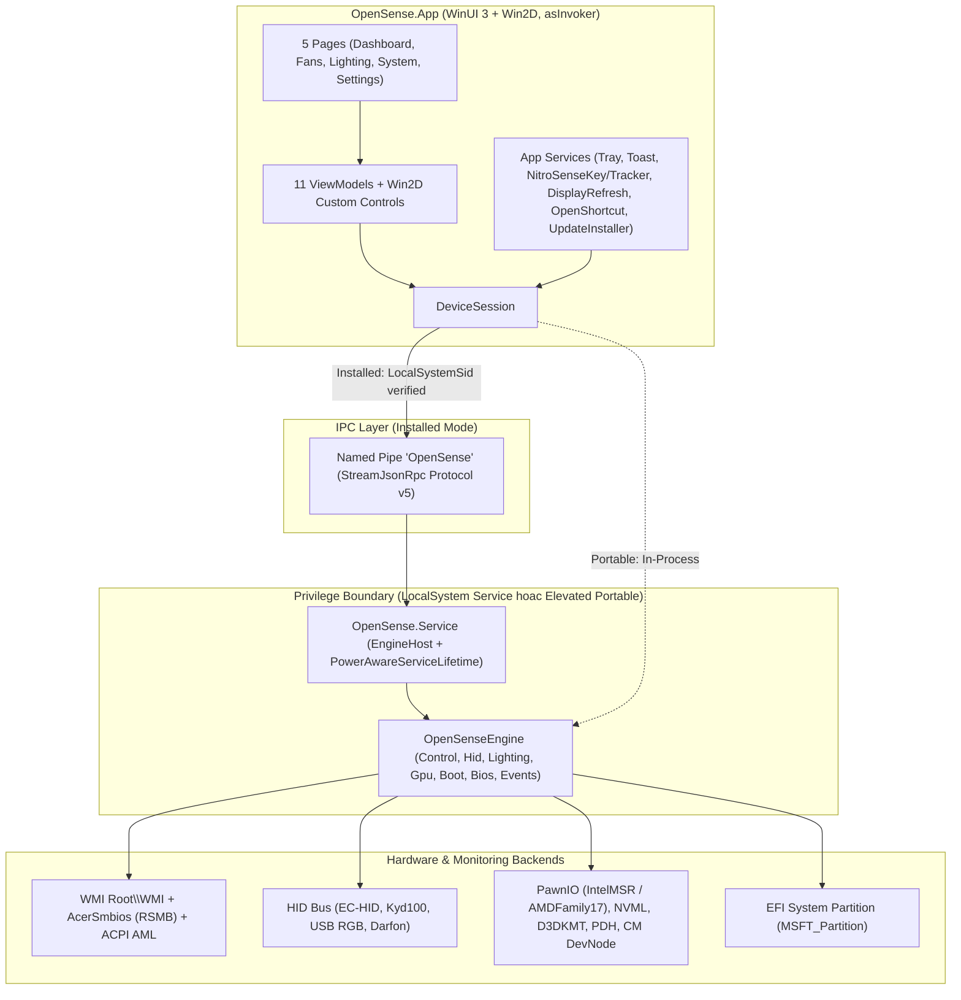

# Báo cáo Scan Mã Nguồn: OpenSense

> **Phạm vi scan:** Toàn bộ cấu trúc giải pháp `OpenSense.sln` tại `d:\opensense` (`src/`, `installer/`, `.github/workflows/`, cấu hình gốc và bộ test `tests/OpenSense.Core.Tests/`).  
> **Phiên bản trong mã nguồn:** `0.3.7` ([Directory.Build.props](file:///D:/opensense/Directory.Build.props)) · **Target Framework:** `net10.0-windows10.0.19041.0`

---

## 1. Tổng quan dự án & Stack công nghệ

**OpenSense** là phần mềm mã nguồn mở thay thế Acer NitroSense / PredatorSense trên Windows cho các dòng laptop gaming Acer, tách biệt rõ ràng phần giao diện người dùng (chạy ở quyền chuẩn `asInvoker`) khỏi tầng điều khiển phần cứng và đọc cảm biến đặc quyền (chạy dưới Windows Service `LocalSystem` hoặc chế độ Portable nâng quyền UAC).

| Thành phần | Công nghệ / Cấu hình |
|---|---|
| Ngôn ngữ & Runtime | C# (`LangVersion=latest`), .NET 10 (`net10.0-windows10.0.19041.0`), .NET SDK tối thiểu `10.0.401` (`rollForward: latestFeature`, [global.json](file:///D:/opensense/global.json); máy cục bộ đã cài `10.0.404`) |
| Phân tích tĩnh & An toàn bộ nhớ | `Nullable=enable`, `ImplicitUsings=enable`, `AnalysisLevel=latest-recommended`, `EnforceCodeStyleInBuild=true`, `AllowUnsafeBlocks` tại `OpenSense.Core` & `OpenSense.App` |
| UI Framework | WinUI 3 unpackaged self-contained (`WindowsPackageType=None`, `WindowsAppSDKSelfContained=true`, WindowsAppSDK `2.5.1`), Win2D (`1.4.0`), `CommunityToolkit.Mvvm` (`8.4.2`), `CommunityToolkit.WinUI.Controls.{Segmented,SettingsControls}` (`8.2.251219`), `H.NotifyIcon.WinUI` (`2.4.1`) |
| IPC & Hosting | `StreamJsonRpc` (`2.25.29`, `SystemTextJsonFormatter`, `HeaderDelimitedMessageHandler`), `Microsoft.Extensions.*` (`10.0.12`), `Serilog` (`4.4.0`) |
| Win32 P/Invoke & WMI | `Microsoft.Windows.CsWin32` (`0.3.335`), `System.Management` (`10.0.12`), kernel driver nhúng PawnIO (`AMDFamily17.bin`, `IntelMSR.bin`, LGPL-2.1) |
| Kiểm thử | `xunit.v3` (`4.0.1`), `Microsoft.Testing.Platform`, `Microsoft.Testing.Extensions.CodeCoverage` (`18.11.2`), `TimeProvider.Testing` (`10.10.0`) |
| Đóng gói & CI | NSIS 3.12.0 ([installer/OpenSense.nsi](file:///D:/opensense/installer/OpenSense.nsi)), GitHub Actions `windows-2025` ([build.yml](file:///D:/opensense/.github/workflows/build.yml)) |

---

## 2. Kiến trúc tổng thể & Hai chế độ thực thi

OpenSense hỗ trợ **2 mô hình vận hành** quyết định bởi việc Windows Service `OpenSense` đã được đăng ký tại `HKLM\SYSTEM\CurrentControlSet\Services\OpenSense` hay chưa (`OpenSensePipe.IsServiceInstalled`):

1. **Installed Mode (Service + UI không cần UAC):**
   - `OpenSense.Service` chạy dưới tài khoản `LocalSystem`, khởi chạy `OpenSenseEngine` bên trong `EngineHost` và lắng nghe Named Pipe `"OpenSense"`.
   - `OpenSense.App` chạy ở quyền user chuẩn (`asInvoker` trong [app.manifest](file:///D:/opensense/src/OpenSense.App/app.manifest)), kết nối qua `DeviceSession` tới pipe `"OpenSense"` mà không hiển thị hộp thoại UAC.
2. **Portable Mode (In-process Engine):**
   - Khi service chưa cài, [Program.cs](file:///D:/opensense/src/OpenSense.App/Program.cs) của `OpenSense.App` kiểm tra `!OpenSensePipe.IsServiceInstalled && !SystemInfo.IsElevated` và tự khởi động lại bằng `runas` để có quyền nâng cao.
   - `DeviceSession` chạy `OpenSenseEngine` trực tiếp trong cùng tiến trình UI, tự lắng nghe `SystemEvents.PowerModeChanged` & `SystemEvents.SessionEnded`.

---

## 3. Cấu trúc giải pháp & Chi tiết từng Module

### 3.1. `OpenSense.Core` ([OpenSense.Core.csproj](file:///D:/opensense/src/OpenSense.Core/OpenSense.Core.csproj))

Thư viện lõi chứa toàn bộ logic nghiệp vụ, giao thức phần cứng, giám sát cảm biến và hợp đồng IPC; chia sẻ trực tiếp kiểu internal cho `OpenSense.Core.Tests` thông qua `InternalsVisibleTo`.

| Namespace / Thư mục | Các thành phần chính | Vai trò |
|---|---|---|
| `Ipc/` | `IOpenSenseService`, `OpenSensePipe`, `PipeServer` | Hợp đồng `[JsonRpcContract]` (sự kiện `TelemetryUpdated`, `NoticeRaised`, `Rebuilt`, `SettingsChanged` và các RPC điều khiển/cấu hình), kiểm tra `ProtocolVersion = 5`, ACL và định danh `LocalSystemSid`. |
| `Engine/` | `OpenSenseEngine` và các partial (`Bios`, `Boot`, `Gpu`, `Hid`, `Lighting`, `Events`) | Bộ điều phối trung tâm đồng bộ bởi `_sessionGate`, `_settingsGate`, `_runtimeGate`. Lưu `settings.json` debounce 400ms và `state.json` ngay lập tức; giữ `_bootLogoGate`; xử lý HID arrival/removal với bộ trễ ổn định 2s (`HidSettleDelay`). |
| `Settings/` | `Settings.cs` (`UserSettings`, `MachineSettings`, `SettingsStore<T>`, `SettingsPaths`), `RuntimeState.cs` | Cấu hình tách biệt per-user (`%APPDATA%\OpenSense\settings.json`, gồm `UiSettings.RefreshRateOnBattery` mặc định `true`) và per-machine (`%ProgramData%\OpenSense\settings.json`, schema version 3 hỗ trợ `Upgrade()` từ v1/v2). Ghi file nguyên tử qua `.tmp` và sao lưu file JSON lỗi thành `.bad`. `state.json` lưu `Calibration`, `GpuClocks`, `GpuOverclockApplied`, `ModeKeySeen`, `BatteryBoostSeen`. |
| `Updates/` | `GitHubUpdater.cs`, `PortableUpdate.cs` | Kiểm tra GitHub Releases API (bỏ qua draft/prerelease), chọn gói `*-Setup-{arch}.exe` hoặc `*-Portable-{arch}.zip` qua `SelectAsset`. Bắt buộc kiểm tra `sha256:` digest (`VerificationFailure.NoDigest` / `DigestMismatch`). `PortableUpdate.CopyOver` sao lưu và rollback khi gặp `IOException` / `UnauthorizedAccessException`. |
| `Control/` | `FanControlService.cs`, `PowerService.cs`, `KeyboardService.cs`, `LightingService.cs`, `OperatingModePolicy.cs`, `GpuClockSettings.cs`, `GpuClockController` | `FanControlService` chạy trên thread nền chuyên biệt `"OpenSense control loop"` (poll 1s, trung bình `CurveInterval` 3s, `CurveFollower` lấy max 2 mẫu nhiệt độ gần nhất với deadband 2%, tái áp đặt 30s, `FailsafeAfterMisses = 3`, `AntiThrottle`, khóa quạt ở `Quiet`/`Eco`, `DustDefender` poll 5s tối đa 10 phút, `RestoreAutoOnExit` khi dispose). `PowerService` quản lý giới hạn sạc 80%, sạc USB khi tắt máy (`10/20/30%`) và quy trình hiệu chuẩn pin. `KeyboardService` & `LightingService` gộp xung (coalescing async pump) giới hạn 150ms/đèn (`MinInterval`) và trễ sau wake 6s (`ResumeDelay`). |
| `Hardware/` | `WmiTransport.cs`, `AcerSmbios.cs`, `AcpiModeCode.cs`, `AcerFirmwareProfile.cs`, `BiosSettings.cs`, `WindowsSettings.cs`, [DisplayRefresh.cs](file:///D:/opensense/src/OpenSense.Core/Hardware/DisplayRefresh.cs) | Giao tiếp WMI `@"\\.\root\WMI"` có mutex; đọc SMBIOS `'RSMB'` qua `GetSystemFirmwareTable` (bảng OEM `0xAC`, `0xAA`); phân tích AML trong `HKLM\HARDWARE\ACPI` tìm `WMBH`/`SetGamingMiscSetting(0x16)` gán `0x0B`; áp dụng quirk cho 15 BIOS đã review; whitelist ~50 thiết lập BIOS an toàn; thiết lập Windows theo người dùng (`StickyKeys`, `PowerPlans`, `WindowsRestart`); và điều phối tần số quét màn hình (`DisplayRefreshPolicy`, `WindowsDisplayRefreshBackend`, `DisplayRefreshController`). |
| `Hardware/Boot/` | `BootLogoImage.cs`, `BootLogoStore.cs` | Kiểm tra ảnh GIF87a/89a hoặc baseline JPEG chuẩn Insyde trước khi ghi vào phân vùng EFI (`MSFT_Partition`) theo quy trình temp → flush → delete → move. |
| `Hardware/Hid/` | `HidBus.cs`, `HidChannel.cs`, `EcHidDevice`, `EcHidProtocol`, `Kyd100Device`, `Kyd100Protocol`, `UsbKeyboardDevice`, `UsbKeyboardProtocol`, `DarfonDevice`, `DarfonProtocol` | Giao tiếp HID cấp thấp (kênh tự mở lại handle cũ sau sleep), hỗ trợ EC-HID (`VID 1025 PID 174B`, report `0xA0`, mutex `Global\ECHIDFeatureVID_1025&PID_174B`), Kyd100 (`0xFF5A`), bàn phím USB (Chicony `04F2`, Sunrex `05AF`, Darfon `0D62`, MagForce) và Darfon. |
| `Lighting/` | `HidLights`, `KeyboardAnimation`, `EcKeyboardBackend`, `EcKeyboardBrightnessBackend`, `EcLightBarBackend`, `EcLogoBackend`, `Kyd100Backend`, `UsbKeyboardBackend`, `MagKeyBackend`, `DarfonBackend` | Backend điều khiển đèn RGB bàn phím, light bar, logo và bộ giả lập hiệu ứng `KeyboardAnimation` theo chu kỳ 10ms khớp EC trên AN515-57. |
| `Monitoring/` | `DirectSensors.cs`, `ThermalLimits.cs`, `PawnIOModule.cs`, `CpuTemperatureSensor.cs`, `NvmlLibrary.cs`, `NvmlGpuSensor.cs`, `NvmlGpuClocks.cs`, `WindowsGpuSensor.cs`, `GpuPowerState.cs`, `LoadMonitor.cs`, `PdhQuery.cs`, `GpuAdapters.cs`, `SensorReadings.cs`, `SensorStatus.cs` | Đọc nhiệt độ, ngưỡng nhiệt (`ThermalLimits`), tải CPU/GPU và ép xung GPU không làm thức dGPU đang ngủ. |

### 3.2. `OpenSense.Service` ([OpenSense.Service.csproj](file:///D:/opensense/src/OpenSense.Service/OpenSense.Service.csproj))

Windows Service nhẹ gồm 3 file nguồn chính:
- [Program.cs](file:///D:/opensense/src/OpenSense.Service/Program.cs): Bảo mật thư mục máy qua `SettingsPaths.SecureMachineDirectory()`, cấu hình Serilog ghi log theo ngày (lưu 7 ngày tại `%ProgramData%\OpenSense\logs\service-.log`), gắn `PowerAwareServiceLifetime` làm host lifetime.
- [PowerAwareServiceLifetime.cs](file:///D:/opensense/src/OpenSense.Service/PowerAwareServiceLifetime.cs): Đặt `CanHandlePowerEvent = true` để nhận trực tiếp sự kiện `Suspend`, `ResumeAutomatic` và `PowerStatusChange` từ Windows SCM.
- [EngineHost.cs](file:///D:/opensense/src/OpenSense.Service/EngineHost.cs): Khởi chạy `PipeServer.RunAsync` trước khi bật `Task.Run(() => engine.Start())`.

### 3.3. `OpenSense.App` ([OpenSense.App.csproj](file:///D:/opensense/src/OpenSense.App/OpenSense.App.csproj))

Ứng dụng WinUI 3 đóng gói unpackaged (`AssemblyName=OpenSense`, hỗ trợ `x64;ARM64`, bật `DISABLE_XAML_GENERATED_MAIN` để dùng `Program.cs` tùy chỉnh, và chứa MSBuild target `AddWindowsAppRuntimeVersionInfo` giải nén `Microsoft.WindowsAppRuntime.Insights.Resource.dll` nhằm khắc phục lỗi WindowsAppSDK #6071/#6725).

- **Vòng đời khởi động & Kích hoạt cửa sổ ([App.xaml.cs](file:///D:/opensense/src/OpenSense.App/App.xaml.cs)):**
  - `OnLaunched` đăng ký `NitroSenseKey`, `OpenShortcut` và hook `_instance.Activated` / `ExitRequested` qua `DispatcherQueue` **trước** khi tạo `MainWindow`, `TrayService` và `ToastService`; đẩy `AutostartService.Refresh()` sang `Task.Run` (await lại trước `ShellViewModel.InitializeAsync()`) và giữ cờ `_showPending` nếu phím được bấm lúc cửa sổ đang khởi tạo.
  - `ShowMainWindow()` phục hồi cửa sổ đang minimize (`OverlappedPresenter.Restore()`), gọi `AppWindow.Show()` + `_window.Activate()`, sau đó dùng `BringToForeground` (`AttachThreadInput` + `BringWindowToTop` + `SetForegroundWindow`, kèm fallback đảo `HWND_TOPMOST`/`HWND_NOTOPMOST`) để vượt qua foreground lock khi mở từ background raw input lúc chạy nền (`--autostart`).
  - Lắng nghe `SystemEvents.SessionEnded` để gọi `SettingsService.Flush()` khi Windows tắt/khởi động lại.
- **Khởi động & Một thực thể (`Startup/`):**
  - `LaunchOptions.cs`: Phân tích tham số CLI (`Exit`, `EnableAutostart`, `DisableAutostart`, `StartService`, `ApplyUpdate`).
  - [SingleInstance.cs](file:///D:/opensense/src/OpenSense.App/Startup/SingleInstance.cs): Dùng sự kiện đặt tên `Local\OpenSense.Activate` & `Local\OpenSense.Exit` với `EventWaitHandleAcl` cấp quyền `Modify | Synchronize` cho `AuthenticatedUserSid` (người dùng hiện tại giữ `FullControl`), cho phép tiến trình không nâng quyền đánh thức thực thể Portable đang nâng quyền UAC (điều mà `AppInstance` mặc định của WinAppSDK không làm được). Gọi `AllowSetForegroundWindow(uint.MaxValue)` trước khi signal `Activate` trong `SignalExisting()` và trường hợp race tại `Claim()`.
- **Dịch vụ ứng dụng (`Services/`):**
  - [DeviceSession.cs](file:///D:/opensense/src/OpenSense.App/Services/DeviceSession.cs): Quản lý kết nối Pipe (`ConnectTimeout=3s`, `StartupWait=30s`, vòng lặp tự kết nối lại `RetryDelay=2s`), đối chiếu `snapshot.ProtocolVersion != OpenSensePipe.ProtocolVersion`, hòa giải cấu hình từ xa với trễ ổn định `LocalChangeSettle=2s` (`OnSettingsChanged` / `ReconcileAsync`).
  - `AutostartService.cs`, `AutostartTask.cs`, `ScheduledTasks.cs`: Mode Installed ghi `HKCU\...\Run\OpenSense`; mode Portable tạo tác vụ Task Scheduler `"OpenSense autostart ({Environment.UserName})"` (`RunLevel=HighestAvailable`, `DisallowStartIfOnBatteries=false`, `StopIfGoingOnBatteries=false`, `ExecutionTimeLimit=PT0S`) qua COM `ITaskService` để tự chạy khi đăng nhập không cần UAC.
  - [NitroSenseKey.cs](file:///D:/opensense/src/OpenSense.App/Services/NitroSenseKey.cs), [NitroSenseKeyTracker.cs](file:///D:/opensense/src/OpenSense.App/Services/NitroSenseKeyTracker.cs), `OpenShortcut.cs`, `MessageWindow.cs`: Tạo cửa sổ ẩn `HWND_MESSAGE` (không cần quyền admin); bắt phím cứng NitroSense/PredatorSense qua `RegisterRawInputDevices` (`RIDEV_INPUTSINK`) cho scan code `E0 75` (`0x01:0x06`) và Acer vendor HID (`0x88:0x01`, report `[1] == 0x81 && [2] == 0xFF`, giữ con trỏ `RAWHID*` trực tiếp vào buffer và duyệt đủ `dwCount` report). Có fallback đăng ký từng thiết bị (`RegisterSingle`), retry giới hạn theo backoff (`1s, 2s, 4s, 8s, 15s`) qua `NitroSenseKeyTracker` khi khởi động sớm lỗi, và hook `SystemEvents.SessionSwitch` / `PowerModeChanged` để reset phím kẹt và làm mới đăng ký; cùng phím tắt mở nhanh qua `RegisterHotKey` (`MOD_NOREPEAT`).
  - [DisplayRefreshService.cs](file:///D:/opensense/src/OpenSense.App/Services/DisplayRefreshService.cs): Lắng nghe `SystemEvents.PowerModeChanged` (`StatusChange`, `Resume` kèm recheck sau `1.5s`), `SessionSwitch` (`SessionUnlock`) và `DeviceSession.TelemetryUpdated` trong phiên desktop người dùng; tự hạ các màn hình hỗ trợ xuống `60 Hz` (fallback `59 Hz`) khi dùng pin và khôi phục tần số quét cao nhất khi cắm sạc, đồng thời hiển thị toast thay thế nhau (`tag: "refreshrate"`, hết hạn sau `1` phút) qua `ToastService` khi tần số quét thực sự thay đổi. Có công tắc bật/tắt `System_RefreshRateOnBattery` tại trang `System` -> `Display`.
  - `TrayService.cs`, `ToastService.cs`, `NotificationService.cs`: Tray icon (`H.NotifyIcon`) với tooltip giới hạn `ToolTipLimit = 127` ký tự, menu chọn fan/mode; thông báo dùng `AppNotificationManager` ở chế độ Installed và tray balloon ở chế độ Portable/elevated.
  - `UpdateInstaller.cs`: Xác định `InstallKind` bằng so khớp `InstallLocation == AppDirectory` trong HKLM 64-bit; chạy bộ cài `/S /Relaunch` (`runas`) cho bản Installed, hoặc giải nén sang `%TEMP%\OpenSense-update` và gọi trực tiếp `OpenSense.exe --apply-update <dir> --wait <pid>` (`UseShellExecute=false`) giữ nguyên quyền nâng cao cho bản Portable.
- **Custom Controls Win2D (`Controls/`):**
  - `CanvasElement.cs`: Lớp nền tạo `CanvasControl` khi `Loaded`, gọi `_canvas.RemoveFromVisualTree()` khi `Unloaded` (tránh rò rỉ tài nguyên GPU Win2D) và ép `FlowDirection.LeftToRight`.
  - `FanRotor.cs`: Quạt 9 cánh dùng Composition `RotationAngleInDegrees` (easing cubic-Bezier `RampLength=800ms`), hiệu ứng nhòe chuyển động tỷ lệ tốc độ, tự tạm dừng animation khi `!App.Current.IsWindowVisible` hoặc Windows tắt animation.
  - `FanCurveEditor.cs`: Kéo điểm trực tiếp, double-tap thêm điểm, chuột phải xóa điểm (tối thiểu 2 điểm), chỉnh bằng bàn phím (`Arrow` / `Shift+Arrow` / `Tab`), bám bước `AcerProtocol.FanSpeedStep`, tự căn nhãn không đè bằng `CurveLabelPlacement.Fit`.
  - `HistoryChart.cs`: Biểu đồ vùng gradient 300 mẫu (`MonitorViewModel.HistoryLength`) theo `TemperatureScale`, vẽ đường tải `%` phụ và ngắt đoạn khi dữ liệu `null`.
  - `KeyboardPreview.cs`, `LightBarPreview.cs`, `LogoPreview.cs`, `PerKeyKeyboard.cs`, `KeyboardLayouts.cs`: Xem trước bàn phím (chạy `KeyboardAnimation` qua `CompositionTarget.Rendering`, `MaxCatchUp=100`, `HardwareDelay=30ms` cho `EcKeyboard`), chọn từng phím (click / `Ctrl`-click / kéo vùng) theo layout `Assets/Layouts/{ansi,iso,jis}.json`.
  - `TileGrid.cs`: Panel tùy chỉnh tính số cột tối ưu để giảm thiểu ô trống ở hàng cuối.
- **ViewModels & Views (`ViewModels/`, `Views/`):**
  - 11 ViewModel (`Battery`, `BiosSettings`, `FanControl`, `GpuClocks`, `Lighting`, `Monitor`, `Settings`, `Shell`, `Startup`, `System`, `Update`) và 5 trang dùng `NavigationCacheMode="Required"`: `DashboardPage`, `FansPage`, `LightingPage`, `SystemPage`, `SettingsPage`.
  - [MainWindow.xaml.cs](file:///D:/opensense/src/OpenSense.App/MainWindow.xaml.cs): Mica backdrop, custom `TitleBar`, kích thước tối thiểu 900x640 (mở rộng tối đa 1220x860), xác nhận trước thao tác nguy hiểm (khởi động lại MUX GPU, hiệu chuẩn pin, cảnh báo ép xung GPU dẫn chiếu issue #17 tại [GpuClocksViewModel.cs](file:///D:/opensense/src/OpenSense.App/ViewModels/GpuClocksViewModel.cs#L145-L146), xác nhận 2 lớp cho BIOS `Dangerous`, nhập mật khẩu BIOS, mở `FileOpenPicker` gắn `AppWindow.Id` để hoạt động khi nâng quyền Portable).
- **Đa ngôn ngữ (`Localization/`, `Strings/`, `docs/`, `installer/`):**
  - `AppLanguage.cs` hỗ trợ **36 ngôn ngữ** (bao gồm `vi-VN` và 3 ngôn ngữ RTL `ar-SA`, `fa-IR`, `he-IL`), thiết lập đồng bộ `ApplicationLanguages.PrimaryLanguageOverride`, `SetProcessPreferredUILanguages`, `CultureInfo.DefaultThreadCurrentUICulture`.
  - 36 thư mục `Resources.resw` trong `src/OpenSense.App/Strings/`, 36 file `.nsh` trong `installer/`, và 12 bản dịch `docs/README-*.md` ngoài [README.md](file:///D:/opensense/README.md).

### 3.4. Bộ cài đặt NSIS & CI/CD

- **NSIS ([OpenSense.nsi](file:///D:/opensense/installer/OpenSense.nsi)):** Nén LZMA (từ điển 64MB), bắt buộc x64 và Windows build `>= 19041` (`MIN_WINDOWS_BUILD`). Khi cài đặt: dừng app đang chạy (`--exit`), gỡ service cũ (`net stop` + `sc delete`), cài thầm `PawnIO_setup.exe -install -silent` nếu chưa thấy trong HKLM Uninstall, đăng ký Windows Service `OpenSense` (`start= auto depend= Winmgmt`, cấu hình recovery `restart/5000/restart/10000/restart/60000` trong 86400s). Bộ gỡ dùng danh sách file sinh lúc build (`${UNINSTALL_LIST}`), dọn COM registration `AppUserModelId` trừ cờ `/Update`, và hỏi xóa `%ProgramData%\OpenSense`, `%APPDATA%\OpenSense`, `%LOCALAPPDATA%\OpenSense` (mặc định không `/SD IDNO`).
- **GitHub Actions ([build.yml](file:///D:/opensense/.github/workflows/build.yml)):** Chạy trên `windows-2025`, chạy test `Release` (`dotnet test --project tests/OpenSense.Core.Tests -c Release`), publish self-contained `win-x64` ReadyToRun cho App & Service, kiểm tra SHA-256 của `PawnIO_setup.exe` v2.2.0, sinh `uninstall-files.nsh`, biên dịch installer NSIS 3.12.0, đóng gói zip Portable và phát hành GitHub Release khi có tag `v*`.

---

## 4. Cơ chế giao tiếp Phần cứng & Cảm biến

1. **Nhận diện Model & Firmware:**
   - Kết hợp dữ liệu SMBIOS (`0xAC`, `0xAA` qua `AcerSmbios`), phân tích mã ACPI AML (`AcpiModeCode`) tìm mẫu điều khiển `WMBH` / `SetGamingMiscSetting(0x16)` và bảng 15 firmware `AcerFirmwareProfile` (như `ANV15-51` ZYP vs ZYQ, `NL16-71G`, `PH717-71`, `PHN16-73`, `ANV16-41`, `ANV16S-61`) để chọn `ModeRules` (`Gaming` vs `EmbeddedController`), xử lý `PowerLimit` và ánh xạ phím mode (`Cycle` vs `TurboToggle`).
2. **Đọc cảm biến trực tiếp không qua WMI chậm & tránh đánh thức dGPU (`DirectSensors.cs`):**
   - **CPU:** Dùng driver PawnIO nạp module nhúng (`IntelMSR.bin` đọc MSR `0x1A2`, `0x1B1`; `AMDFamily17.bin` đọc SMN `0x00059800` bảo vệ bởi mutex `Global\Access_PCI`). `DirectSensors` lọc giá trị bất thường ngoài `(0, 150]` °C / non-finite (chặn lỗi glitch như `AmdTctlSensor.Decode(0xFFFFFFFF) == 206.875`), và chuẩn hóa ngưỡng nhiệt (`IntelCpuDefault = 100`, `AmdCpuDefault = 95`, `GpuDefault = 87`, kẹp trong `60..130`).
   - **GPU NVIDIA & Intel/AMD:** Ưu tiên `NvmlLibrary` -> `NvmlGpuSensor` (`ThresholdPerformanceScaling = 7`) & `NvmlGpuClocks` (dùng `nvmlDevice{Get,Set}ClockOffsets` trên driver >= 555 và fallback sang `Gpc/MemClkVfOffset`). Nếu không có NVML, fallback sang `WindowsGpuSensor` dùng D3DKMT (`D3DKMTOpenAdapterFromLuid` + `KMTQAITYPE_ADAPTERPERFDATA`, chu kỳ mở lại `ReopenInterval = 30s`).
   - **Trạng thái nguồn dGPU (`WindowsGpuPowerState`):** Đọc `DEVPKEY_Device_PowerData` và `DEVPKEY_PciDevice_D3ColdSupport` qua `CM_Get_DevNode_Property` (không đánh thức dGPU đang ngủ; trả về `null` nếu đang D0 mà không hỗ trợ D3Cold trên máy đa GPU) để `GpuClockController` bỏ qua dGPU đang ngủ.
   - **Tải CPU/GPU (`LoadMonitor.cs`):** PDH `\Processor Information(_Total)\% Processor Utility` (fallback `% Processor Time`) và `\GPU Engine(*engtype_3D)\Utilization Percentage` lọc theo LUID từ DXGI (`GpuAdapters`, loại bỏ adapter phần mềm `0x1414`); xuống cấp an toàn về `UnavailableLoadMonitor` nếu thiếu counter.

---

## 5. Bảo mật, Phân quyền & An toàn phần cứng

OpenSense thể hiện tư duy phòng thủ theo chiều sâu rất rõ ràng cho một công cụ thao tác cấp firmware/kernel:

- **Cách ly quyền & Bảo vệ Named Pipe:** `PipeServer` khởi tạo bằng `FirstPipeInstance`, đặt chủ sở hữu `LocalSystemSid`, **từ chối tường minh `NetworkSid` (`FullControl`)**, chỉ cho phép `LocalSystem` & `BuiltinAdministrators` (`FullControl`) và `AuthenticatedUsers` (`ReadWrite | Synchronize`). Ở chiều client, `OpenSensePipe.IsTrustedServer` kiểm tra lại chủ sở hữu pipe phải là `LocalSystemSid` trước khi trao đổi RPC.
- **Bảo vệ tệp cấu hình máy:** `SettingsPaths.SecureMachineDirectory()` khóa ACL thư mục `%ProgramData%\OpenSense`. Toàn bộ thay đổi ghi xuống đĩa theo cơ chế temp + replace nguyên tử.
- **Chống DLL Hijacking:** `NvmlLibrary` ([NvmlLibrary.cs](file:///D:/opensense/src/OpenSense.Core/Monitoring/NvmlLibrary.cs#L53)) nạp `nvml.dll` bằng đường dẫn tuyệt đối từ `SystemDirectory` hoặc `ProgramFiles\NVIDIA Corporation\NVSMI`; `PawnIOModule` tra `InstallLocation` trong HKLM 64-bit rồi mới nạp `PawnIOLib.dll`.
- **Toàn vẹn bản cập nhật:** `GitHubUpdater` từ chối cài hoặc xóa ngay file tải về nếu thiếu digest `sha256:` hoặc sai hash; `build.yml` kiểm tra hash SHA-256 của `PawnIO_setup.exe` v2.2.0 khi build.
- **Kiểm soát BIOS phía Server:** `OpenSenseEngine.Bios.cs` tự kiểm tra `Current.Bios.Allows(risk)` trên service (không chỉ tin UI), ép mật khẩu BIOS thuần ASCII trong `BiosPasswordMaxLength` và không ghi mật khẩu ra log; setting không có trong danh sách an toàn mặc định coi là `BiosRisk.Dangerous`.
- **Cơ chế hồi phục & Failsafe phần cứng:**
  - *Quạt (`FanControlService`):* Rớt cảm biến liên tiếp 3 lần (`FailsafeAfterMisses = 3`) tự trả về điều khiển tự động của EC; luôn duy trì sàn chống throttle `AntiThrottle` và khôi phục chế độ Auto khi thoát (`RestoreAutoOnExit`).
  - *Ép xung GPU (`OpenSenseEngine.Gpu.cs`):* Cờ `GpuOverclockApplied` ghi trong `state.json`; nếu máy sập nguồn bất ngờ/BSOD khi đang ép xung, lần khởi động sau tự tắt OC và bật `TurnedOffAfterCrash = true`.
  - *Hiệu chuẩn pin (`PowerService`):* Lưu `CalibrationRecord` vào `state.json`, giữ `PowerCreateRequest`, khôi phục giới hạn sạc và cấu hình power/lid-switch ngay cả khi bị ngắt điện, rút sạc hoặc gián đoạn giữa chừng.
  - *Boot Logo (`OpenSenseEngine.Boot.cs` & `BootLogoImage`):* Kiểm tra định dạng/kích thước chuẩn Insyde khớp độ phân giải màn hình trong máy trước khi ghi vào ESP.

---

## 6. Bộ kiểm thử & Trạng thái thực thi

### 6.1. Phạm vi bộ test (`tests/OpenSense.Core.Tests/`)

Qua thống kê, `tests/OpenSense.Core.Tests/` có **396** method đánh dấu `[Fact]` / `[Theory]` (mở rộng thành **652** test case khi thực thi), đồng thời link trực tiếp 3 helper/logic thuần từ `OpenSense.App` (`CurveLabelPlacement.cs`, `AutostartTask.cs`, [NitroSenseKeyTracker.cs](file:///D:/opensense/src/OpenSense.App/Services/NitroSenseKeyTracker.cs)) để kiểm thử mà không phụ thuộc WinUI/Win32:
- **Test harnesses:** `SimulatedLaptop`, `FakeFirmware`, `FakeHid` (mô phỏng WMI/EC/HID/BIOS/SMBIOS), `SourceTree`, kèm các fixture thật cho ACPI (`Fixtures/Acpi/`) và migration cấu hình (`SettingsTests`).
- **Nhóm kiểm thử chính đã ghi nhận:** `PipeTests`, `IpcTests` (kiểm tra ACL/pipe security), `FoundationTests`, `SettingsTests`, `ModelDetectionTests`, `ControlTests`, `CoolingTests`, `EcHidTests`, `BatteryTests`, `BootTests`, `BiosSettingsTests`, `GpuClockTests`, `RecoveryLifetimeTests` (gồm giả lập glitch AMD Tctl và vòng đời khôi phục), `UpdaterTests`, `AutostartTaskTests`, `CurveLabelTests`, [NitroSenseKeyTests.cs](file:///D:/opensense/tests/OpenSense.Core.Tests/NitroSenseKeyTests.cs) (9 test cho `E0 75`, `ResetKeyState()`, khớp HID nhiều report và retry theo `FakeTimeProvider`), [DisplayRefreshTests.cs](file:///D:/opensense/tests/OpenSense.Core.Tests/DisplayRefreshTests.cs) (14 test case cho policy 60 Hz/max Hz, chuyển trạng thái pin/sạc, màn hình phụ 60 Hz cố định, lock-screen retry throttling và khôi phục sau unlock/resume), và `LocalizationTests` (dùng regex quét toàn bộ lời gọi `Strings.Get` / `Strings.Format` trong mã nguồn đối chiếu với 36 ngôn ngữ).

### 6.2. Trạng thái thực thi kiểm thử & Build

- **Unit tests (`.NET SDK 10.0.404`):** `dotnet test --project tests\OpenSense.Core.Tests\OpenSense.Core.Tests.csproj` (chạy ngoài sandbox để kết nối IPC test host) → **Passed 652/652** (`failed: 0`, `skipped: 0`).
- **Build & Publish:**
  - `dotnet build src\OpenSense.App\OpenSense.App.csproj` → Thành công (`0 Error`, `2 Warning` `NU1902` có sẵn từ package `MessagePack 2.5.302`).
  - `dotnet publish` bản `Release` (`win-x64`, `--self-contained`, `PublishReadyToRun=true`, `-p:Version=0.3.7`) cho cả `OpenSense.App` và `OpenSense.Service` vào [artifacts/publish/OpenSense](file:///D:/opensense/artifacts/publish/OpenSense).
- **Chưa kiểm chứng tự động:** Phần Win32/WinUI tích hợp trong `NitroSenseKey.cs`, `App.xaml.cs` và `WindowsDisplayRefreshBackend` chưa chạy E2E tự động trên phần cứng/màn hình thật sau restart Windows hoặc rút/cắm sạc thực tế.

---

## 7. Nhận xét chất lượng mã nguồn & Các điểm lưu ý

Tổng thể mã nguồn sạch, cấu trúc tách lớp rõ ràng, nhất quán chuẩn C# hiện đại (`Nullable=enable`, khóa bất đồng bộ rạch ròi, xử lý tài nguyên native cẩn thận). Một số điểm nhỏ đáng lưu ý khi bảo trì:

1. **Thiếu hủy đăng ký một event trong `StopControl()`:** Tại [OpenSenseEngine.cs](file:///D:/opensense/src/OpenSense.Core/Engine/OpenSenseEngine.cs#L344-L348), `StopControl()` hủy đăng ký `TelemetryUpdated`, `Notice`, `GpuClockLimitsChanged`, `GpuOverclockApplied`, nhưng bỏ sót `BatteryBoostSeen -= OnBatteryBoostSeen` (thực tế ít rủi ro do controller cũng được dispose ngay sau đó, nhưng nên bổ sung cho đối xứng).
2. **Đọc đồng bộ trạng thái đèn lúc khởi động:** Tại [OpenSenseEngine.Lighting.cs](file:///D:/opensense/src/OpenSense.Core/Engine/OpenSenseEngine.Lighting.cs#L29), `_lightingAtStart = lighting.ReadAsync().GetAwaiter().GetResult()` chặn đồng bộ trên hàng đợi `_controller`.
3. **Phạm vi khóa trong `GetDiagnosticsAsync()`:** Tại [OpenSenseEngine.Events.cs](file:///D:/opensense/src/OpenSense.Core/Engine/OpenSenseEngine.Events.cs#L21-L68), hàm chỉ giữ `_sessionGate` quanh `_hid?.Enumerate()` trong khi đọc `_firmware`, `_detected`, `_capabilities`, `_hidLights`, `Runtime` ngoài lock — có khả năng quan sát trạng thái đang rebuild dở dang nếu trùng thời điểm kết nối lại thiết bị.
4. **Kiểm tra kích thước ảnh Boot Logo sau khi deserialize RPC:** `SetBootLogoAsync(byte[] image)` trong `OpenSenseEngine.Boot.cs` kiểm tra `BootLogoRules.MaxBytes` sau khi `StreamJsonRpc` (với cấu hình mặc định trong `OpenSensePipe`) đã nhận mảng byte qua pipe.
5. **Phím tắt toàn cục không bắt buộc modifier:** [SettingsViewModel.cs](file:///D:/opensense/src/OpenSense.App/ViewModels/SettingsViewModel.cs#L232-L244) và [SettingsPage.xaml.cs](file:///D:/opensense/src/OpenSense.App/Views/SettingsPage.xaml.cs#L38) cho phép ghi một phím đơn bất kỳ cho phím tắt mở app (có ghi chú thiết kế là có chủ ý theo XML doc `"any key, alone or with modifiers"`), dựa vào `RegisterHotKey(..., MOD_NOREPEAT, ...)` — nếu hệ điều hành chấp nhận một phím đơn không có modifier thì phím đó sẽ bị chiếm toàn cục.
6. **Gắn event lại khi `DeviceSession` tự kết nối lại:** Tại [DeviceSession.cs](file:///D:/opensense/src/OpenSense.App/Services/DeviceSession.cs#L524) (gọi từ `ConnectAsync` dòng 403), khi khôi phục kết nối sau lúc service khởi động lại, phiên mới đăng ký handler trên `_service` mới mà không gỡ handler khỏi đối tượng cũ đã dispose (hành vi vô hại vì connection cũ đã đóng).
7. **Tham chiếu tài liệu chưa có trong repo:** Một số chú thích trong [FakeHid.cs](file:///D:/opensense/tests/OpenSense.Core.Tests/FakeHid.cs#L8) và [EcHidTests.cs](file:///D:/opensense/tests/OpenSense.Core.Tests/EcHidTests.cs#L11) nhắc tới `docs/PROTOCOL.md`, tuy nhiên thư mục `docs/` hiện tại chỉ chứa 12 file `README-*.md` dịch từ README gốc.
8. **Độ phức tạp & hành vi phòng hờ ở luồng NitroSense key ([App.xaml.cs](file:///D:/opensense/src/OpenSense.App/App.xaml.cs#L159-L187), [NitroSenseKey.cs](file:///D:/opensense/src/OpenSense.App/Services/NitroSenseKey.cs#L228-L240)):** `BringToForeground` dùng `AttachThreadInput` kèm bật/tắt `HWND_TOPMOST`/`HWND_NOTOPMOST` (có thể chững thoáng qua nếu thread cửa sổ foreground đang treo), và `RecoverAfterDesktopTransition` khi retry lại sau unlock/resume không gọi `RIDEV_REMOVE` trước khi đóng `_window` nếu đăng ký mới thất bại hoàn toàn (đăng ký cũ trỏ vào `HWND` đã huỷ cho tới lần retry thành công).
